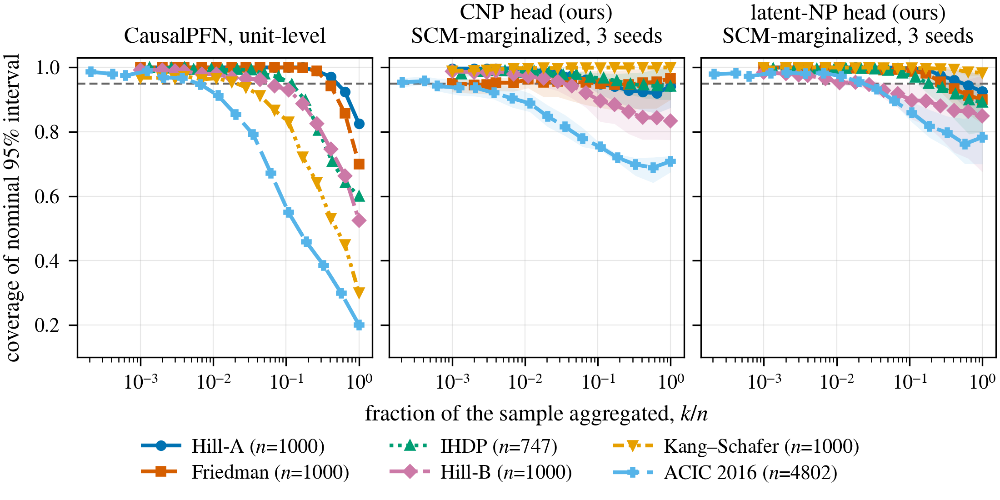

# Unit-level aggregation breaks coverage in causal foundation models

Gabe Schulman, Lucius E.J. Bynum, Yoav Wald · [arXiv:2610.22770](https://arxiv.org/abs/2610.22770)

Causal foundation models (CFMs) form credible intervals for group-averaged
effects by combining unit-level predictive variances as if the errors on
different units were independent. Posterior uncertainty over the
data-generating process makes these errors correlated, so coverage degrades as
the group grows. Neural process models that make joint predictions for a group
of units account for this correlation and substantially improve coverage.

<p align="center"></p>

*Coverage of nominal 95% intervals for the average CATE over k of n units on
six benchmarks. Left: CausalPFN with unit-level aggregation. Middle and right:
our neural process heads on the frozen CausalPFN (Figure 3).*

## Setup

```bash
conda env create -f environment.yml
conda activate subsetcate
pip install -e .
```

Steps that run CausalPFN use `environment-causalpfn.yml`, and fetching the
OpenML tables uses `environment-cfmdata.yml`.

## Figures and tables

```bash
make verify
```

This checks the result files in `logs/` against `artifacts.sha256` and
regenerates every figure and table from them in about ten seconds on a CPU.

| paper | script |
|---|---|
| Figure 1 | `experiments/make_figure_benchmarks.py` |
| Figure 2 | `experiments/make_figure_twopath.py` |
| Figure 3 | `experiments/cfm/make_figure_cfm_heads.py` |
| Figure 4 | `experiments/make_figure_collapse.py` |
| Figures 5, 6 | `experiments/cfm/make_figure_fixed_weight.py` |
| Tables 2–6 | `docs/latex/build_tex_tables.py` |
| Tables 7, 8 | `experiments/cfm/final_tables.py` |

## Training and evaluation

These steps need a GPU. The trained models are in `checkpoints/`, and
`MANIFEST.md` lists the script and settings behind each result file.

**Synthetic tasks.** `configs/{cnp,latent_np}_seed{0,1,2}.sh` train the CNP
and the latent NP (1–2 hours each), and `experiments/two_path_ablation.py`
evaluates them. `experiments/inspec_stage{1,2,3}.py` and
`experiments/subset_selection_coverage.py` evaluate CausalPFN.

**CausalPFN on the benchmarks.**

```bash
benchmarks/get_ihdp.sh && benchmarks/get_acic2016.sh
(cd benchmarks && python run_causalpfn_pit.py 40 pit_calib HillA,HillB,HillBHeavy,FriedmanConf,KangSchafer,IHDP,ACIC2016 true 2000 true)
PIT_PARTS=benchmarks/results_pfn_pit/pit_calib/parts python experiments/benchmark_ladder.py
```

**Heads on CausalPFN.**

```bash
benchmarks/get_openml_tables.sh
bash configs/cfm/v2_cnp_rand_s0.sh    # about 6 hours on one L40S
python experiments/cfm/eval_final.py --method v2_cnp_rand_s0=checkpoints/cfm/v2_cnp_rand_s0.pt \
    --out logs/cfm/final/v2_cnp_rand_s0.json
```

## Notes

- CausalPFN is used as released: `causalpfn==0.1.4` from PyPI, which is
  commit `3a40991` of [vdblm/CausalPFN](https://github.com/vdblm/CausalPFN).
  The line numbers the appendix cites at commit `7da4afa` are the same. The
  weights are `causalpfn_v0.pt` from Hugging Face `vdblm/causalpfn`, sha256
  `4f0f53717f1c62426fe98faa0459d33bc8f9862a87e8484ca3869ca899e7841d`.
- The datasets are not redistributed. The scripts in `benchmarks/` download
  IHDP and the OpenML tables and check them against the files we used, and
  generate ACIC 2016 with its official R package.

## Citation

```bibtex
@article{schulman2026unitlevel,
  title   = {Unit-level aggregation breaks coverage in causal foundation models},
  author  = {Schulman, Gabe and Bynum, Lucius E. J. and Wald, Yoav},
  journal = {arXiv preprint arXiv:2610.22770},
  year    = {2026}
}
```

## License

MIT. The model code builds on [metadentify](https://github.com/lbynum/metadentify)
([arXiv:2606.19361](https://arxiv.org/abs/2606.19361)).
